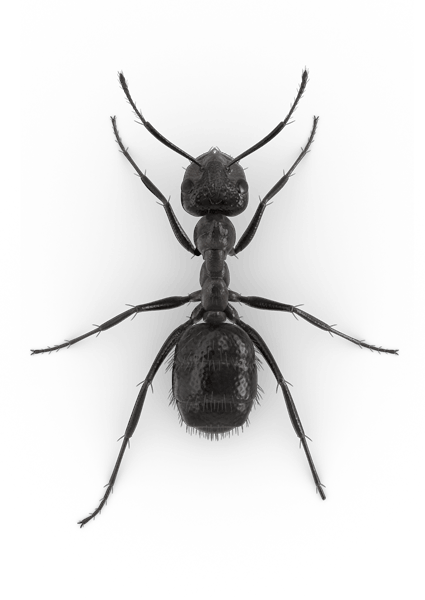
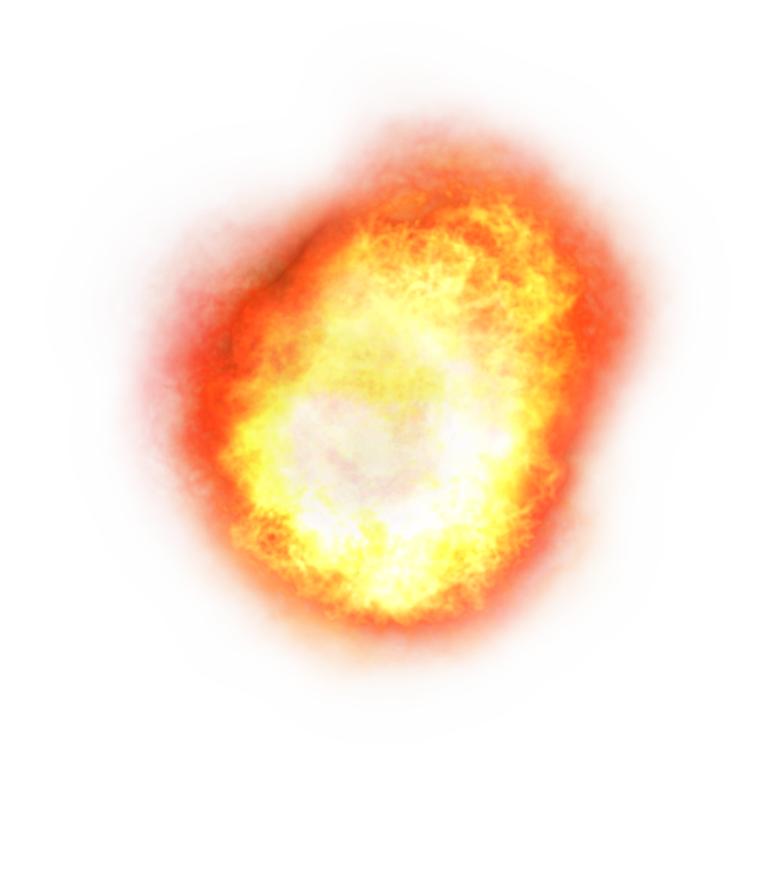

<div align="center">



<br/>

[](https://flutter.dev)
[](https://dart.dev)
[](#-getting-started)


</div>

---

## 🎮 About

**Ant Squash** is a fast-paced arcade game built with Flutter. Hungry ants swarm toward a cake in the middle of the screen. Tap them before they reach it. Every ant that gets through damages the cake, and when its health runs out, the game is over.

<div align="center">
  
  &nbsp;&nbsp;➜&nbsp;&nbsp;
  
  &nbsp;&nbsp;💥&nbsp;&nbsp;
  
</div>

## ✨ Features

| | |
|---|---|
| 🐜 **Endless ant waves** | Enemies spawn continuously and head straight for the cake |
| 🍰 **Cake health system** | Five hit points, shown in an animated health bar |
| 💥 **Squash effects** | Animated explosions on every successful tap |
| 🏆 **Score tracking** | Live score and best score for the session |
| 👤 **Player profiles** | Enter your name on the start screen |
| 🎨 **Polished UI** | Dark Material 3 theme, animated transitions and ambient effects |

## 🕹️ How to Play

1. Enter your name on the start screen and press **Start**.
2. Tap or click each ant to squash it (**+1 point**).
3. Don't let ants reach the cake. Each hit costs **1 health** (out of 5).
4. When the cake is gone, check your final and best score, then try again.

## 🚀 Getting Started

**Prerequisites:** [Flutter SDK](https://docs.flutter.dev/get-started/install) with Dart `^3.9.2`.

```bash
# Clone the repository
git clone https://github.com/<your-username>/ant_squash_flutter.git
cd ant_squash_flutter

# Install dependencies
flutter pub get

# Run the game
flutter run
```

Pick a target with `flutter run -d chrome`, `-d linux`, `-d windows`, `-d macos`, or a connected Android/iOS device.

### 📦 Download the APK

[](../../actions/workflows/build-apk.yml)

APKs are built automatically by GitHub Actions on every push to `main`, on pull requests, and on manual runs (**Actions → Build APK → Run workflow**). Download them from the run's **Artifacts** section.

To publish a release with the APKs attached, push a version tag:

```bash
git tag v1.0.0
git push origin v1.0.0
```

> Release builds are currently signed with the debug key. Configure a proper keystore before publishing to the Play Store.

## 🗂️ Project Structure

```
lib/
├── main.dart                  # App entry, theme and screen switching
└── components/
    ├── start_screen.dart      # Animated start screen
    ├── game_controller.dart   # Core game loop, collisions, UI
    ├── Enemy.dart             # Ant model
    ├── EnemySpawner.dart      # Wave spawning logic
    ├── Player.dart            # Player data
    ├── health_bar.dart        # Cake health indicator
    ├── ScoreText.dart         # Score display
    ├── Storage.dart           # In-memory high score
    └── image_provider.dart    # Asset paths
assets/images/                 # Ant, cake and explosion sprites
.github/workflows/             # CI: APK build and release
```

## 🛠️ Built With

- [Flutter](https://flutter.dev) – UI toolkit
- [Dart](https://dart.dev) – language
- Material 3 with a custom dark colour scheme

## 🗺️ Roadmap

- [ ] Persistent high scores
- [ ] Difficulty scaling and power-ups
- [ ] Sound effects and music
- [ ] Global leaderboard

## 🤝 Contributing

Contributions are welcome. Fork the repo, create a feature branch, and open a pull request.

---

<div align="center">

Made with 💙 and Flutter by **Muhammad Hammas Rasheed**

</div>
