<div align="center">


<br/>

[](https://flutter.dev)
[](https://dart.dev)
[](#getting-started)
[](../../actions/workflows/build-apk.yml)


<br/>

<a href="#see-it-in-action">Gameplay</a> &nbsp;•&nbsp;
<a href="#features">Features</a> &nbsp;•&nbsp;
<a href="#how-to-play">How to play</a> &nbsp;•&nbsp;
<a href="#meet-the-ants">Ants</a> &nbsp;•&nbsp;
<a href="#getting-started">Get started</a> &nbsp;•&nbsp;
<a href="#roadmap">Roadmap</a>


</div>

**Ant Squash** is a fast-paced arcade game built with Flutter. Hungry ants swarm toward a cake in the middle of the screen. Tap them before they get there, chain squashes into combos, and survive as long as you can. Every ant that reaches the cake costs a heart, and when the hearts run out the game is over.

<div align="center">
  
  &nbsp;&nbsp;➜&nbsp;&nbsp;
  
  &nbsp;&nbsp;💥&nbsp;&nbsp;
  
</div>

<br/>

<a name="see-it-in-action"></a>
<div align="center"></div>

<div align="center">
<table>
  <tr>
    <td align="center">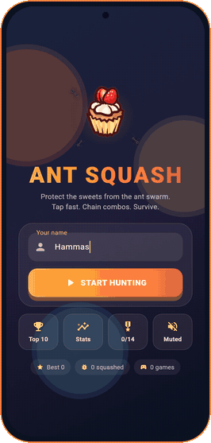</td>
    <td align="center">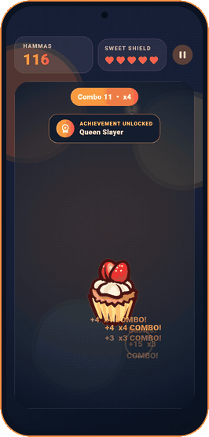</td>
    <td align="center">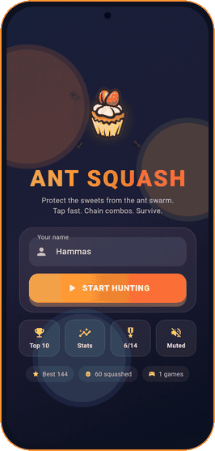</td>
  </tr>
  <tr>
    <td align="center"><b>Start screen</b><br/><sub>Name entry, menu and quick stats</sub></td>
    <td align="center"><b>Gameplay</b><br/><sub>Combos, ant types and unlock popups</sub></td>
    <td align="center"><b>Hall of Fame</b><br/><sub>Stats, achievements and Top 10</sub></td>
  </tr>
</table>

<sub>All media is rendered from the real game UI with <code>tool/capture_frames_test.dart</code> (see <a href="#regenerating-the-media">below</a>).</sub>
</div>

<br/>

<a name="features"></a>
<div align="center"></div>

| | | |
|:--|:--|:--|
| 🐜 **Four ant types**<br/><sub>Normal, fast, tank and queen, each with its own speed, size, health and points.</sub> | 🔥 **Combo multiplier**<br/><sub>Squash within a second of the last hit to build a chain, up to **x5**.</sub> | 👆 **Forgiving taps**<br/><sub>Touch-down input, a generous hit radius, aim assist for moving ants, multi-touch and tap ripples.</sub> |
| 🍰 **Cake health**<br/><sub>Five hearts. Every ant that reaches the cake costs one.</sub> | 🎖️ **14 achievements**<br/><sub>Progress bars, in-game unlock popups and a recap on the game-over screen.</sub> | 📊 **Lifetime stats**<br/><sub>Games played, ants squashed, best combo, time played and more.</sub> |
| 🏆 **Top 10 leaderboard**<br/><sub>Persistent local scores with name and date.</sub> | 🔊 **Sound and haptics**<br/><sub>Squash, hit, combo and game-over sounds with vibration, plus a mute toggle.</sub> | ⏸️ **Pause anywhere**<br/><sub>Pause, restart or quit, with auto-pause when the app goes to the background.</sub> |

<br/>

<a name="how-to-play"></a>
<div align="center"></div>

1. Enter your name on the start screen and press **Start Hunting**.
2. **Tap near an ant** to squash it. You don't have to hit it exactly.
3. Chain squashes within about a second to build a **combo** and multiply your points.
4. Don't let ants reach the cake. Each one that does costs **1 heart** (out of 5) and resets your combo.
5. When the cake is gone, review your run, check what you unlocked, and play again.

> **Combo math:** the multiplier rises by one for every 3 squashes in a chain, up to **x5**. A squash is worth the ant's base points times the current multiplier.

<br/>

<a name="meet-the-ants"></a>
<div align="center"></div>

<div align="center">
<table>
  <tr>
    <td align="center" width="25%">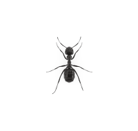<br/><b>Normal</b><br/><sub>From the start</sub><br/><code>1 tap</code> · <code>+1</code></td>
    <td align="center" width="25%">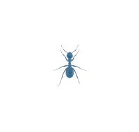<br/><b style="color:#4DB8FF">Fast</b><br/><sub>From score 8</sub><br/><code>1 tap</code> · <code>+2</code></td>
    <td align="center" width="25%">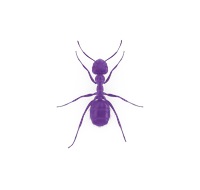<br/><b>Tank</b><br/><sub>From score 20</sub><br/><code>3 taps</code> · <code>+3</code></td>
    <td align="center" width="25%">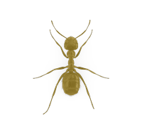<br/><b>Queen</b><br/><sub>From score 40</sub><br/><code>2 taps</code> · <code>+5</code></td>
  </tr>
  <tr>
    <td align="center"><sub>The standard worker.</sub></td>
    <td align="center"><sub>Small, blue and quick.</sub></td>
    <td align="center"><sub>Large, purple and slow. Shows hit-point dots.</sub></td>
    <td align="center"><sub>Gold and huge. Spawns 3 baby ants when squashed.</sub></td>
  </tr>
</table>
</div>

<br/>

### 📸 Screenshots

<div align="center">
<table>
  <tr>
    <td align="center">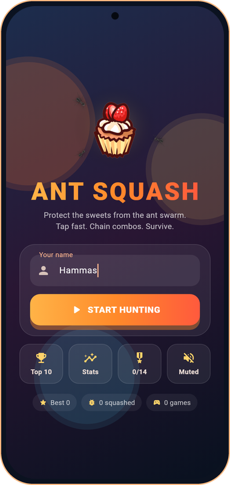</td>
    <td align="center">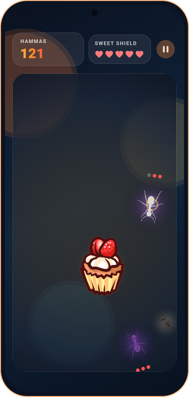</td>
    <td align="center">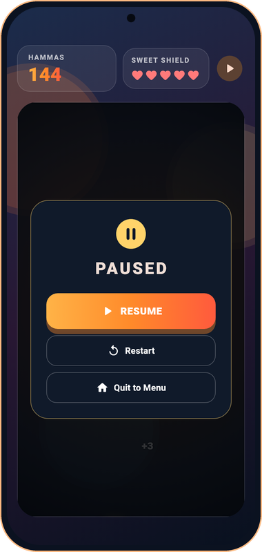</td>
    <td align="center">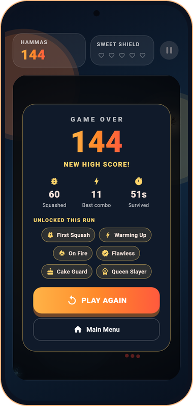</td>
  </tr>
  <tr>
    <td align="center"><sub>Start</sub></td>
    <td align="center"><sub>Play</sub></td>
    <td align="center"><sub>Pause</sub></td>
    <td align="center"><sub>Game over</sub></td>
  </tr>
  <tr>
    <td align="center">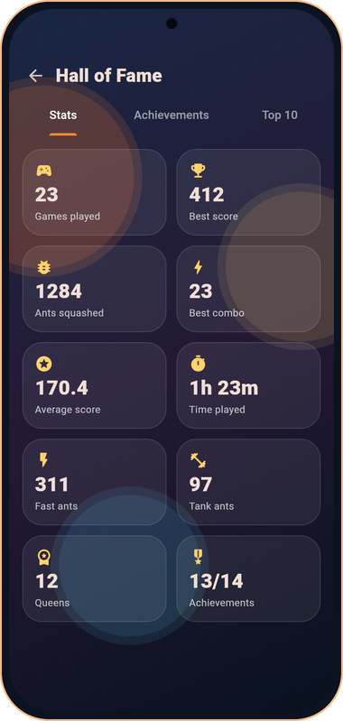</td>
    <td align="center">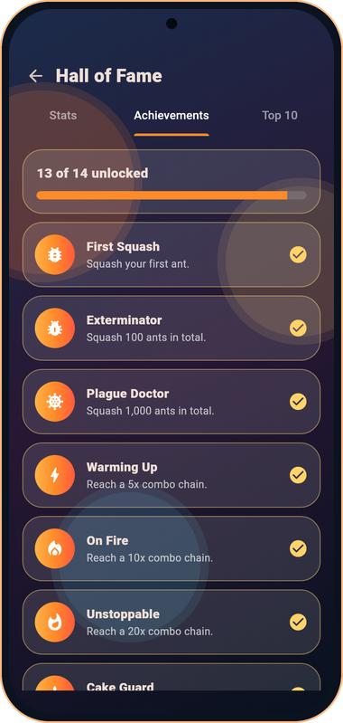</td>
    <td align="center">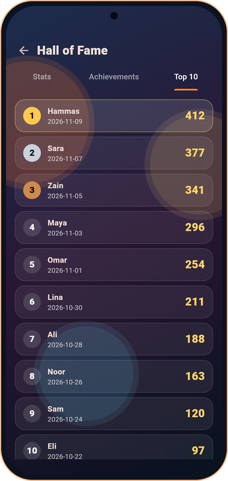</td>
    <td></td>
  </tr>
  <tr>
    <td align="center"><sub>Stats</sub></td>
    <td align="center"><sub>Achievements</sub></td>
    <td align="center"><sub>Top 10</sub></td>
    <td></td>
  </tr>
</table>
</div>

<details>
<summary><b>🎖️ All 14 achievements</b></summary>

| Achievement | How to unlock |
|---|---|
| First Squash | Squash your first ant |
| Exterminator / Plague Doctor | Squash 100 / 1,000 ants in total |
| Warming Up / On Fire / Unstoppable | Reach a 5 / 10 / 20 combo chain |
| Cake Guard / Sweet Defender / Legend of the Cake | Score 50 / 150 / 300 points in one run |
| Quick Hands | Squash 25 fast ants |
| Tank Buster | Squash 10 tank ants |
| Queen Slayer | Squash a queen ant |
| Flawless | Score 30 points without the cake being hit |
| Seasoned Hunter | Play 10 games |

</details>

<br/>

<a name="getting-started"></a>
<div align="center"></div>

**Prerequisites:** [Flutter SDK](https://docs.flutter.dev/get-started/install) with Dart `^3.9.2`.

```bash
# Clone the repository
git clone https://github.com/HammasT1/ant_squash_flutter.git
cd ant_squash_flutter

# Install dependencies
flutter pub get

# Run the game
flutter run
```

Pick a target with `flutter run -d chrome`, `-d linux`, `-d windows`, `-d macos`, or a connected Android/iOS device.

### 📦 Download the APK

APKs are built automatically by GitHub Actions on every push to `main`, on pull requests, and on manual runs (**Actions → Build APK → Run workflow**). Download them from the run's **Artifacts** section.

To publish a release with the APKs attached, push a version tag:

```bash
git tag v1.0.0
git push origin v1.0.0
```

> Release builds are currently signed with the debug key. Configure a proper keystore before publishing to the Play Store.

### 🧪 Testing

```bash
flutter test      # widget and unit tests
flutter analyze   # static analysis
```

<br/>

<a name="project-structure"></a>
<div align="center"></div>

```
lib/
├── main.dart                  # App entry, theme and screen switching
└── components/
    ├── start_screen.dart      # Start screen: name entry and menu
    ├── profile_screen.dart    # Hall of Fame: stats, achievements, top 10
    ├── game_controller.dart   # Game loop, input, collisions, HUD and overlays
    ├── Enemy.dart             # Ant model and ant types
    ├── EnemySpawner.dart      # Spawn logic, type selection and speed cap
    ├── achievements.dart      # Achievement definitions and progress rules
    ├── stats.dart             # Per-run and lifetime stat counters
    ├── Storage.dart           # Persistence (shared_preferences)
    ├── audio_service.dart     # Sound effects and haptics
    ├── ui_kit.dart            # Shared colors, backdrop, cards and buttons
    ├── health_bar.dart        # Cake heart display
    ├── ScoreText.dart         # Score display
    ├── Player.dart            # Cake model
    └── image_provider.dart    # Asset paths
assets/images/                 # Ant, cake and explosion sprites
assets/sounds/                 # Generated sound effects (WAV)
docs/                          # README banners, GIFs and screenshots
tool/                          # Scripts that generate the README media
test/                          # Widget and unit tests
.github/workflows/             # CI: analyze, test, APK build and release
```

<a name="regenerating-the-media"></a>
<details>
<summary><b>🎬 Regenerating the media</b></summary>

<br/>

The GIFs and screenshots are rendered headlessly from the real widgets, so they always match the current UI.

```bash
# 1. Render frames from the game (writes PNGs to build/frames)
FRAMES_DIR=build/frames flutter test tool/capture_frames_test.dart

# 2. Build the phone-framed GIFs and screenshots (needs Pillow and ffmpeg)
python3 tool/make_media.py

# 3. Rebuild the animated banners and section headers
python3 tool/make_svgs.py
```

`capture_frames_test.dart` loads Roboto and the Material icon font from your Flutter SDK. If it lives elsewhere, pass `--dart-define=FONT_DIR=<path>/bin/cache/artifacts/material_fonts`.

</details>

<br/>

<a name="built-with"></a>
<div align="center"></div>

- [Flutter](https://flutter.dev): UI toolkit
- [Dart](https://dart.dev): language
- [shared_preferences](https://pub.dev/packages/shared_preferences): scores, stats and settings storage
- [audioplayers](https://pub.dev/packages/audioplayers): sound effects
- Material 3 with a custom dark colour scheme

<br/>

<a name="roadmap"></a>
<div align="center"></div>

- [x] Persistent high scores and a local leaderboard
- [x] Enemy variety and combo scoring
- [x] Sound effects and haptics
- [x] Achievements and lifetime stats
- [x] Forgiving tap controls
- [ ] Power-ups (freeze, bug spray, extra heart)
- [ ] Background music
- [ ] Game modes (time attack, survival)
- [ ] Global online leaderboard

## 🤝 Contributing

Contributions are welcome. Fork the repo, create a feature branch, and open a pull request.

<div align="center">


Made with 💙 and Flutter by **Muhammad Hammas Rasheed**

</div>
